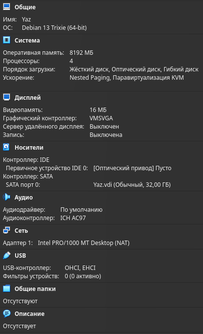

Лабораторная работа №1 - Журавчак Карина ИС-25

Введение в виртуальные машины и установка Debian

Задания:
1. Установка виртуальной машины:
   Я установила и настроила VirtualBox. Создала новую виртуальную машину Yaz, выделив для неё 8 ГБ оперативной памяти и 32 ГБ жесткого диска.
   
