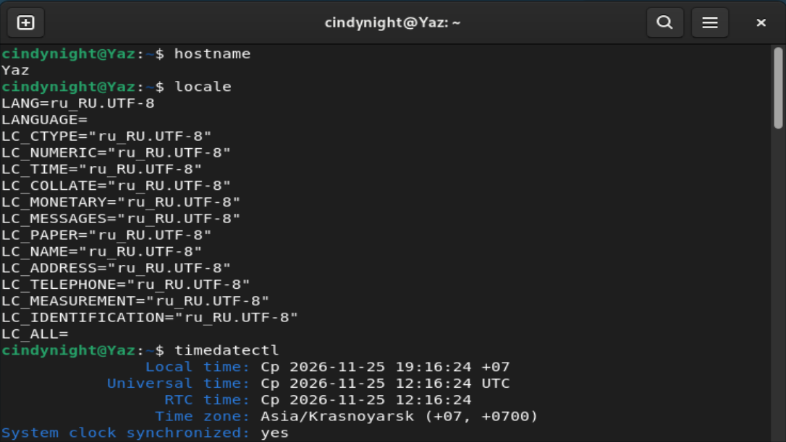
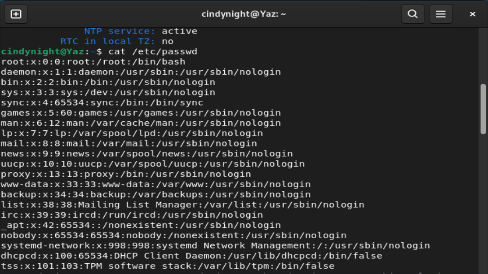
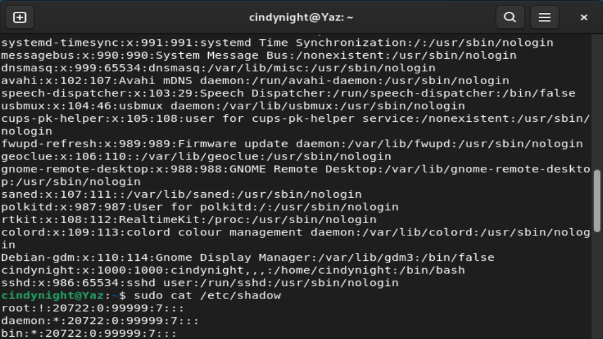
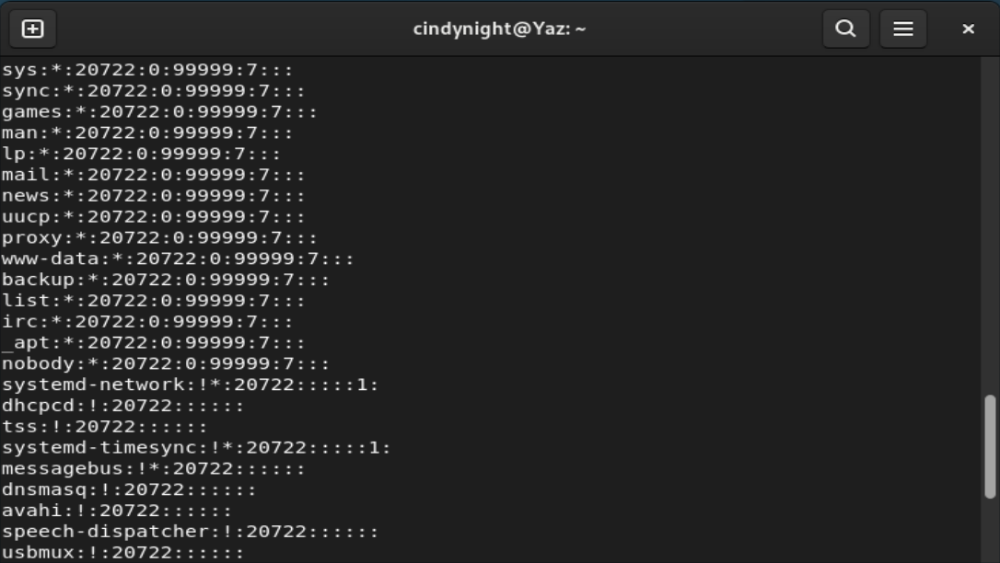
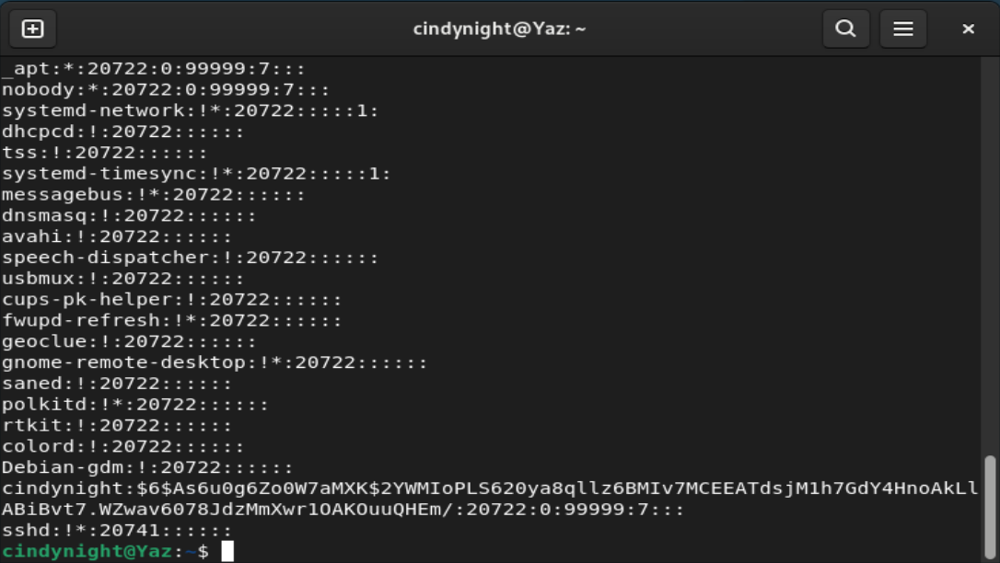
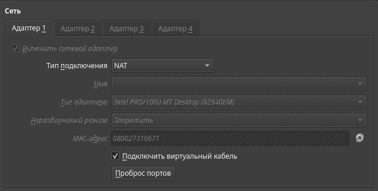
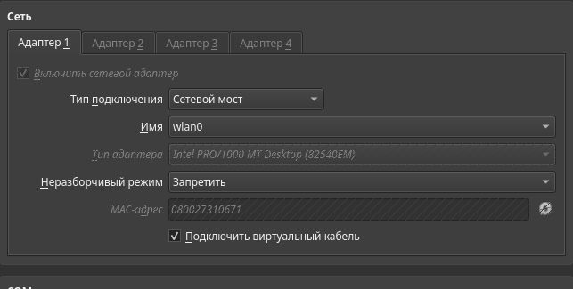
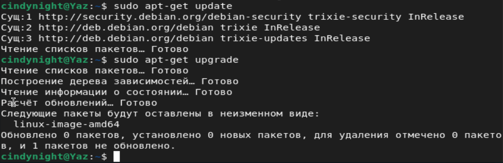
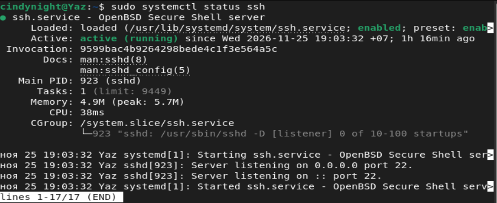
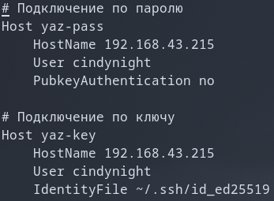

# Лабораторная работа №1 - Журавчак Карина ИС-25

# Введение в виртуальные машины и установка Debian

Задания:
1. Установка виртуальной машины:
   Я установила и настроила VirtualBox. Создала новую виртуальную машину, выделив для неё 8 ГБ оперативной памяти и 32 ГБ жесткого диска.

   

2. Установка Debian:
   Я скачала ISO-образ Debian и установила его на виртуальную машину. Настроила основные параметры: имя компьютера, язык, часовой пояс, пользователи и пароли.

   

   

   

   

   

3. Обновление системы:
   Я настроила подключение к интернету через NAT.

   

   И настроила подключение к интернету через Bridged.

   

   А также выполнила обновление системы, используя sudo apt-get update и sudo apt-get upgrade.

   

4. Настройка SSH:
   Я установила и настроила SSH-сервер.

   

   Я решила создать конфиги для быстрого переключения между входами по паролю и ключу.

   
