# Лабораторная работа №2 - Журавчак Карина ИС-25

# Управление системой и пользователями

Задания:
1. Создание пользователей и групп:
   Я создала трёх новых пользователей: admin, user1, user2.

   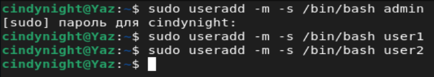

   Задала пароли для пользователей, иначе войти нельзя:

   

   Создала две группы: developers и testers, и добавила в них соответствующих пользователей.

   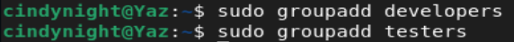

   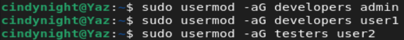

   

2. Настройка прав доступа:
   Я создала каталоги /home/admin/data и /home/admin/logs.

   

   Назначила владельца:

   

   Настроила права доступа к этим каталогам: только пользователь admin может редактировать файлы в data, а группа developers может читать и писать в logs.

   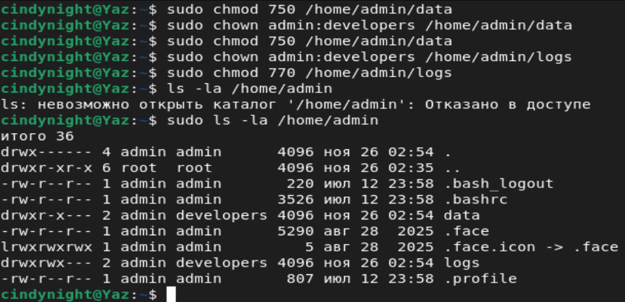

3. Изучение команд для работы с пользователями:
   Я изучила команды useradd, usermod, groupadd, passwd, chown, chmod. Изменила пароль для пользователя user1.

   

   И заблокировала учётную запись пользователя user2 (и разблокировала).

   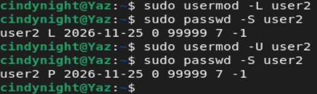

4. Мониторинг активности пользователей:
   Я использовала команды who, w, last для мониторинга активности пользователей. who показывает текущих пользователей в системе. w расширяет эту информацию, добавляя выполняемые процессы и load average. last читает бинарный лог /var/log/wtmp и показывает историю сессий - полезно для аудита.

   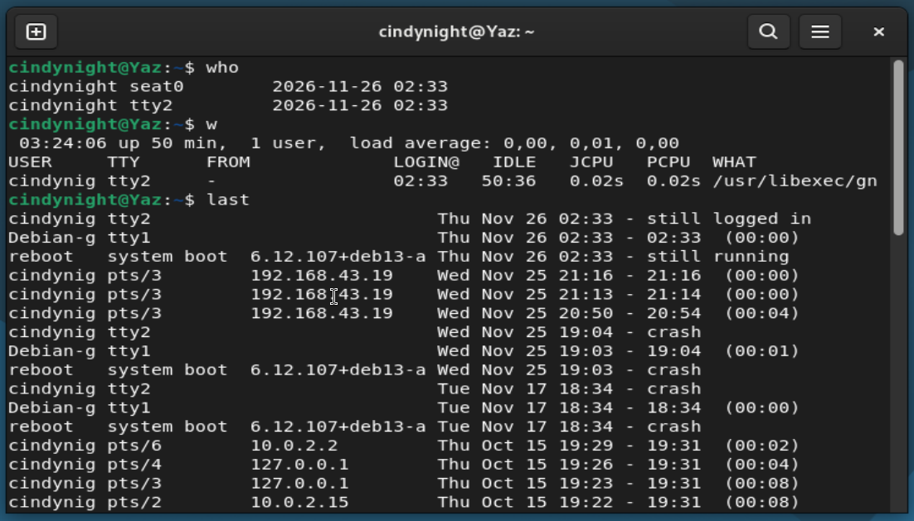

   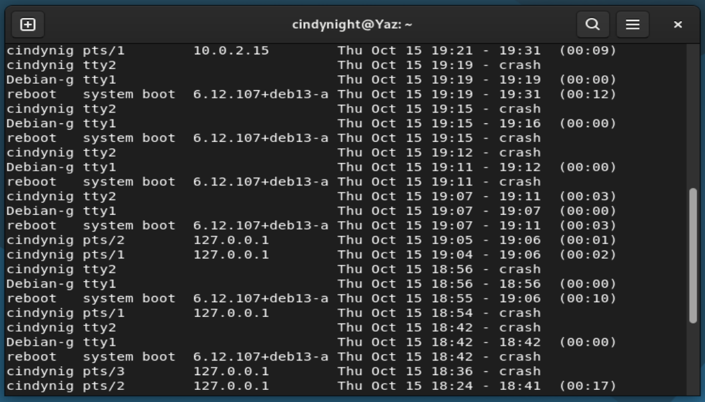

   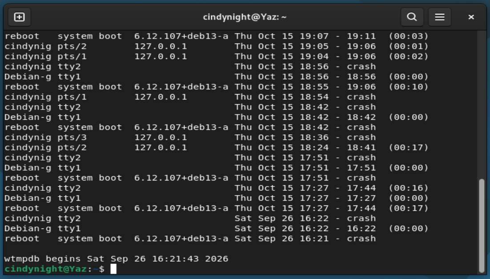

5. Автоматизация управления пользователями:

   Во-первых, сделала текстовый файл с уже заданными именами пользователей и их группами:

   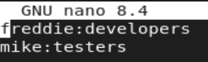

   Я создала bash-скрипт, который автоматически создаёт пользователей и группы из текстового файла с заранее заданными именами.

   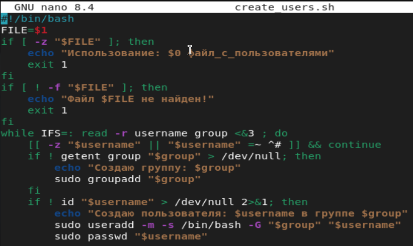
   
   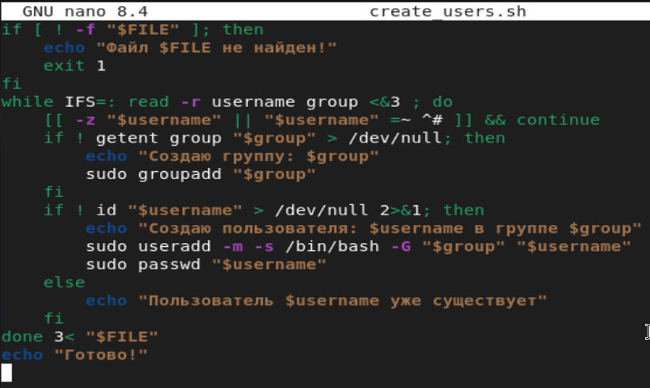
   
   Проверка работы скрипта:

   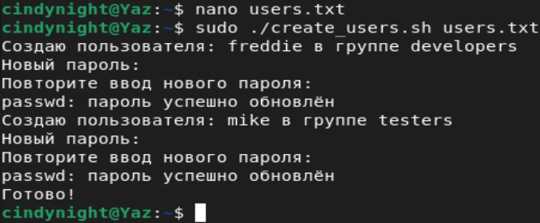
