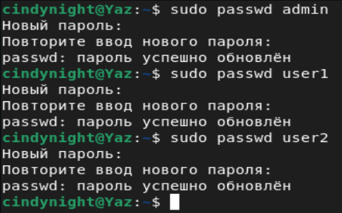
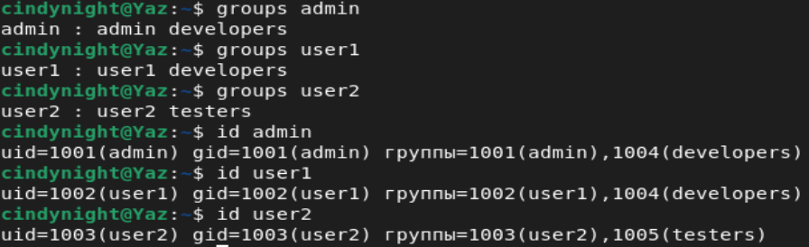
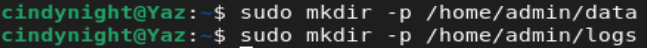
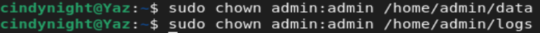
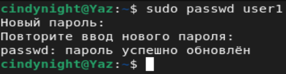

# Лабораторная работа №2 - Журавчак Карина ИС-25

# Управление системой и пользователями

Задания:
1. Создание пользователей и групп:
   Я создала трёх новых пользователей: admin, user1, user2.

   

   Задала пароли для пользователей, иначе войти нельзя:

   

   Создала две группы: developers и testers, и добавила в них соответствующих пользователей.

   

   

   

2. Настройка прав доступа:
   Я создала каталоги /home/admin/data и /home/admin/logs.

   

   Назначила владельца:

   

   Настроила права доступа к этим каталогам: только пользователь admin может редактировать файлы в data, а группа developers может читать и писать в logs.

   

3. Изучение команд для работы с пользователями:
   Я изучила команды useradd, usermod, groupadd, passwd, chown, chmod. Изменила пароль для пользователя user1.

   

   И заблокировала учётную запись пользователя user2 (и разблокировала).

   
