# Лабораторная работа №3 - Журавчак Карина ИС-25

# Управление пакетами, системными сервисами и настройка сети

Задания:
1. Управление пакетами:
   Я настроила файл /etc/apt/sources.list для использования официальных и зеркальных репозиториев Debian.

   

   

   Установила следующие пакеты: vim, curl, net-tools, apache2.

   

   

   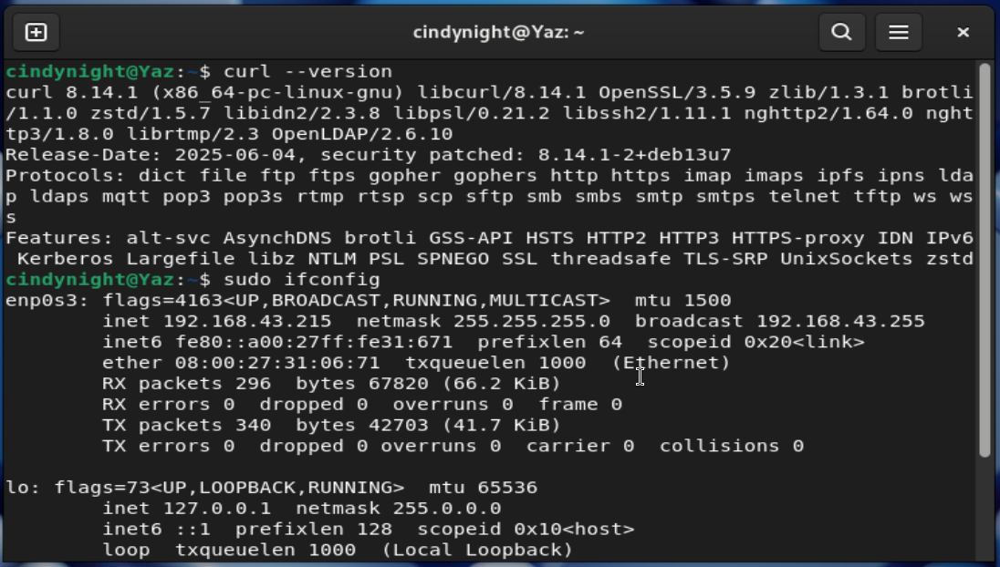

   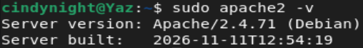

   Создала bash-скрипт, который устанавливает все перечисленные выше пакеты.

   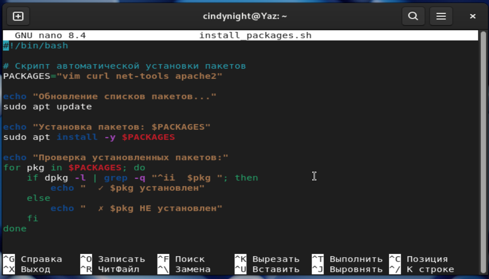

   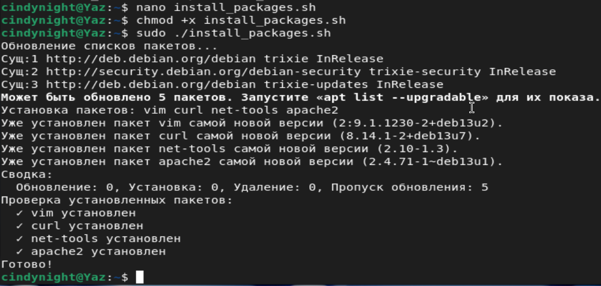

2. Работа с системными сервисами:
   Я настроила автозапуск Apache и SSH при старте системы.

   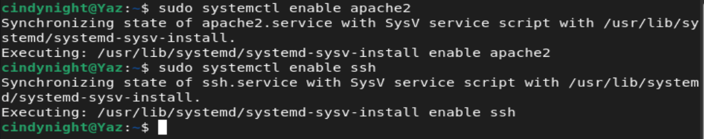

   Использовала команды systemctl для включения, отключения и проверки статусов сервисов.

   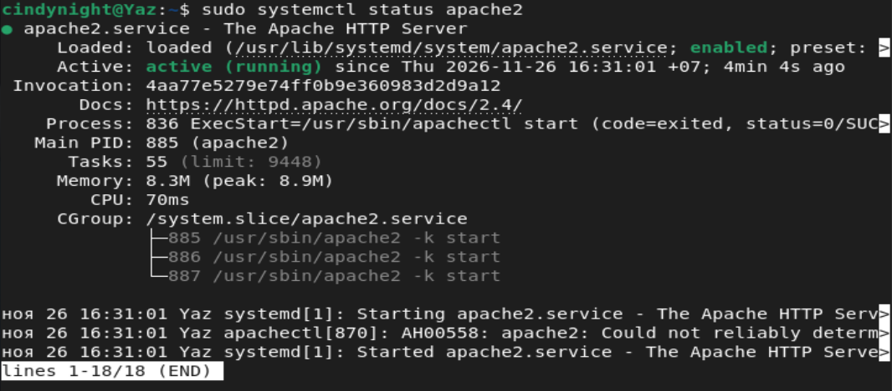

   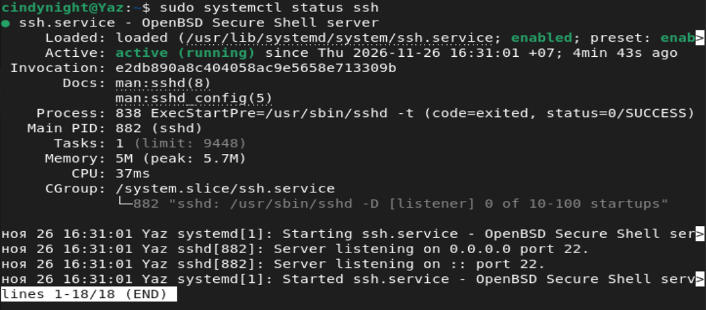

   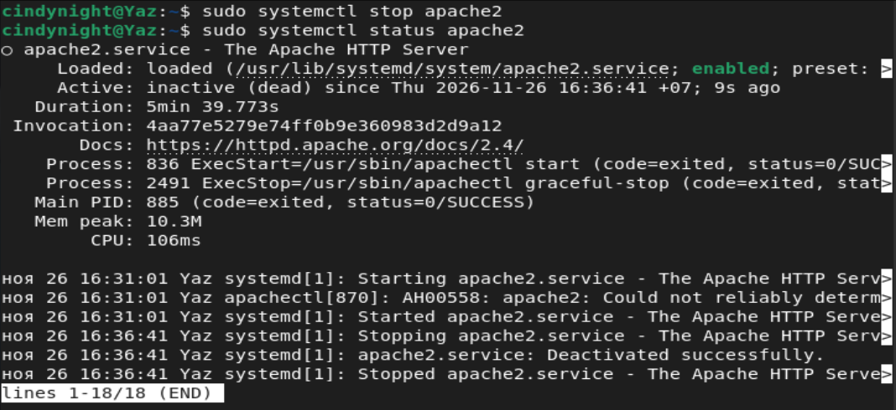

   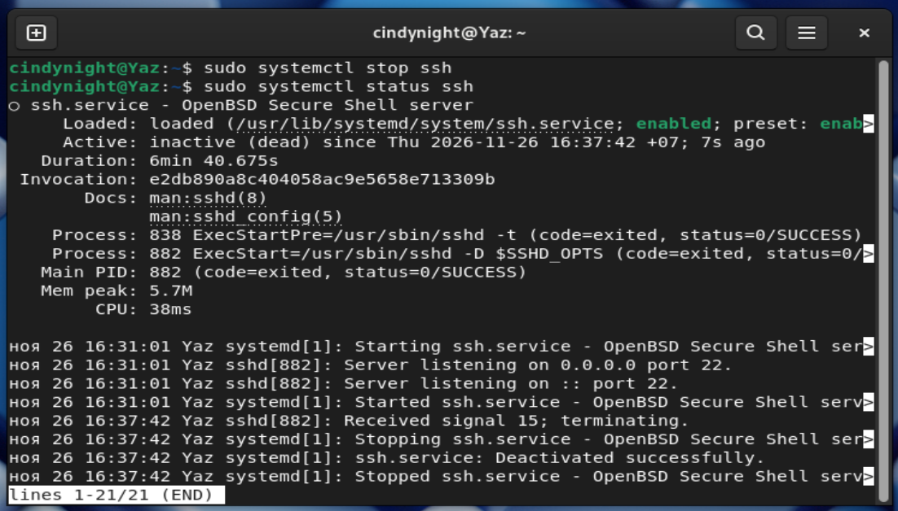

   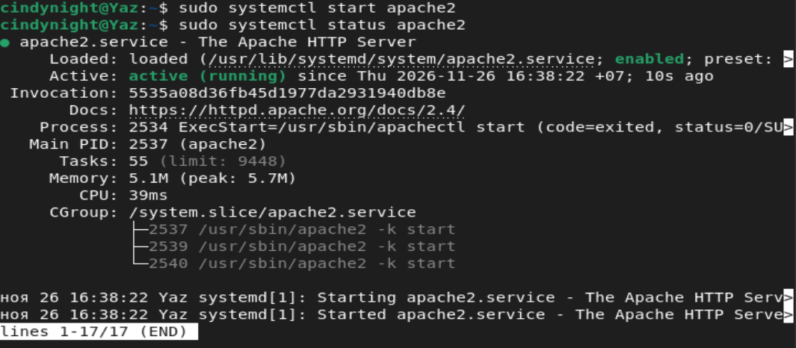

   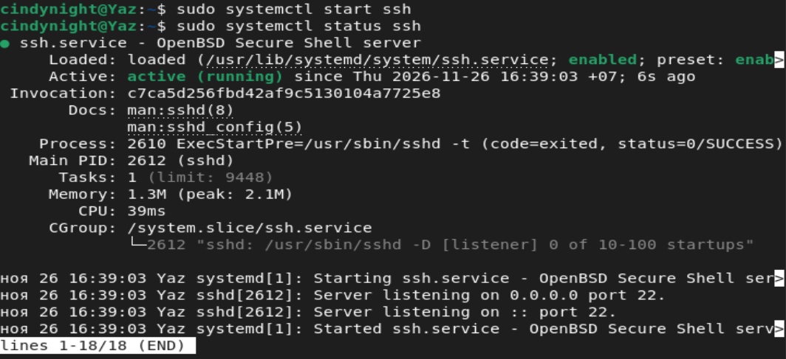
